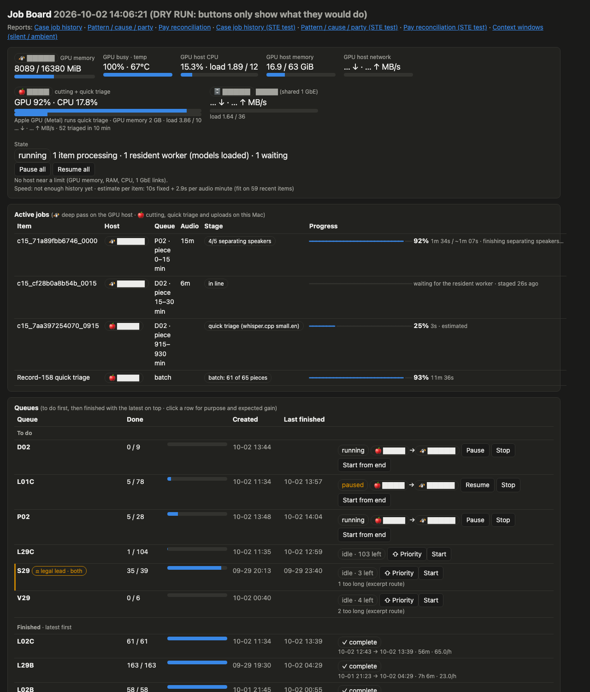

# phone-net · I.C.K.S.

**(phone + net + I.C.K.S.)** · phone+net+tics · *let your phone talk to you*

**Intake · Custody · Keywords · Synthesis**

**Live page:** https://the1truedan.github.io/phone-net-ICKS/ · v0.7.7 Disclosure Edition (2026-10-19) · [Sessions of Therapy](https://the1truedan.github.io/phone-net-ICKS/sessions.html) · public since 2026-09-30 · MIT

A local-only toolkit for family caregivers. It turns the recordings, emails and letters on your **own** phone into an indexed, checksummed, searchable record. With that record you can ask care agencies precise questions in writing, and show how each answer was found.

It was built by one caregiver, between shifts, with AI coding assistants writing the code and every recording staying on local hardware.

> **What is in this repo:** code, config templates, pages and aggregate numbers only.
> **What never is:** recordings, transcripts, names, addresses, case details, or anyone's health information. See `docs/PRIVACY.md`.

## Job board (v0.5.0, updated v0.6.0)
A local page (127.0.0.1 only) to watch and steer the GPU transcription queues: GPU host CPU/memory/GPU and temperature,
items on the GPU with uv-style progress bars (real stage + time left), Start now / Start from end for any queue, Pause/Stop per runner, done/total per queue, recently finished items, pause/resume/start/stop, automatic
cleanup of abandoned staging copies, highlighted queues (e.g. ⚖ legal lead), and formatted local reports.
Since v0.5.6: **Active jobs** for both computers (GPU deep pass and the Mac's cutting, quick triage and uploads, each with a host badge and progress bar),
CPU / GPU / network per host with a plain-language **saturation** line, and to-do queues listed above finished ones (latest finish on top).
Since v0.5.8: **Coverage** watches the checksum list that every phone pull writes and checks each recording, by hash, against the
catalog, the results and the queues. One button queues what nothing covers; one adds new files to the catalog.
Since v0.6.0: an **out-of-date light** on every report page and in the report list (green / yellow / red / grey) from the
newest phone, task, calendar, email or camera data each report depends on (`freshness_sources`, per-report `sources`,
`freshness_red_h`); hours and minutes everywhere; live reload of queue and batch lists; a panel for what is using the Mac GPU.
Camera-clip work runs as short urgency queues (expiring first, then daytime, then deep early-morning scrolls) and each to-do
line is stamped pulled / not in the app list / past the scroll limit / queued after every run.

Standard library only. See `stack/jobboard/README.md`, `stack/requirements/jobboard.txt` and the public-safe example
`docs/examples/case-job-history.example.html`.

## Tools added in v0.6.0

- `scripts/lbf_extract.py`: reads an LG Bridge `.lbf` full-phone backup without the vendor app. Skips the small scrambled index,
  streams the ZIP entries with their original paths and dates, writes a SHA-256 manifest of every entry and extracts databases
  and recordings. Read-only on the backup; hash the original and the copy first.

## What it does

| Stage | What happens |
|---|---|
| **Intake** | USB-C pull from the phone (`adb`), diff against earlier backups by name and size, then verify size and SHA-256 |
| **Custody** | Checksums on every copy and output. True recording dates are recovered from audio metadata when file dates are only copy dates |
| **Keywords** | Level the audio, transcribe it (WhisperX), label speakers (pyannote plus your own voiceprints), run a keyword sweep, then meaning search |
| **Synthesis** | Local summaries, a dated index, packets tiered by audience (family, care team, advocate, counsel), and a methods note |

## By the numbers (2026-10-12)

2,436 phone-pull recordings checked by hash (2,430 covered) · ~760 hours transcribed on local hardware · 4,715 speaker-separated outputs (incl. 1,089 fifteen-minute chunks) · 296 named-caller voicemails QC'd with speaker-name confidence · 325 home-camera clips pulled and timestamp-checked · 568 ledger days · one 16 GB GPU. Full table: `docs/STATS.md`.

## Pages

| Page | What it shows |
|---|---|
| [`index.html`](https://the1truedan.github.io/phone-net-ICKS/) | Summary, breakthroughs timeline, totals and methods |
| [`analytics.html`](https://the1truedan.github.io/phone-net-ICKS/analytics.html) | Daily strips: care notes, emergencies, AI sessions, commits, hours vs the paid cap |
| [`workflow.html`](https://the1truedan.github.io/phone-net-ICKS/workflow.html) | From the phone to the local "black box", with every tool linked |

## Files

| Path | Purpose |
|---|---|
| `docs/PIPELINE.md` | Stages and lessons |
| `docs/MODELS_AND_APPROVALS.md` | Free tools, models, and the Hugging Face gated approvals |
| `docs/BUILD.md`, `stack/` | Docker compose and per-part requirements |
| `docs/STATS.md` | Aggregate numbers (no PII) |
| `docs/PRIVACY.md` | What never goes in this repo |
| `docs/EARMARK_*.md` | Next modules: `cut.glass` (a consent-based, read-only audit of a caregiver app), the real hours-gap chart, and two computers working at once plus a fast first hash (`EARMARK_DUAL_HOST_FAST_HASH.md`) |
| `config/icks.example.yaml` | Paths template. The real `icks.yaml` is git-ignored |
| Session history | Breakthrough citations are checked against a local [AgentsView](https://github.com/kenn-io/agentsview) index |
| `CHANGELOG.md` | What changed in each version, including the breakthroughs |

Working scripts are ported into `scripts/` only after sanitization.

## Self-directed services: official sources

The page explains the roles (the member, the managed care organization, the fiscal employer agent, the county, the caregiver) without naming any organization. Sources:
[Medicaid.gov: Self-Directed Services](https://www.medicaid.gov/medicaid/long-term-services-supports/self-directed-services) ·
[WI DHS SDS FAQ, P-00088N](https://www.dhs.wisconsin.gov/publications/p0/p00088n.pdf) ·
[WI DHS SDS in Family Care, P-00593](https://www.dhs.wisconsin.gov/publications/p0/p00593.pdf) ·
[WI DHS IRIS](https://www.dhs.wisconsin.gov/iris/index.htm) ·
[WI DHS member rights and appeals](https://www.dhs.wisconsin.gov/familycare/fullpartner.htm)

## The larger µlab (M.A.N.A.G.E.R. LLC)

phone-net · I.C.K.S. is one door in a larger µlab. The sibling public repos:

| Repo | Page | What it is |
|---|---|---|
| [ai-gateway](https://github.com/the1truedan/ai-gateway) | [page](https://the1truedan.github.io/ai-gateway/) | Home LLM gateway: routes models across machines. The local gateway these pages refer to |
| [mok-tua](https://github.com/the1truedan/mok-tua) | [page](https://the1truedan.github.io/mok-tua/) | Script → storyboard stills → optional video, on your own GPU |
| [fast-models](https://github.com/the1truedan/fast-models) | [page](https://the1truedan.github.io/fast-models/) | Two spare NVMe drives turned into one fast, deduped model pool |
| [grok-tua-tok-tua](https://github.com/the1truedan/grok-tua-tok-tua) | [page](https://the1truedan.github.io/grok-tua-tok-tua/) | Coding CLIs next to a live health and spend pane |
| [johnny-appleseed-chipper](https://github.com/the1truedan/johnny-appleseed-chipper) | [page](https://the1truedan.github.io/johnny-appleseed-chipper/) | Artifact manifests (C.H.I.P.P.E.R.S.) and custody receipts (C.H.A.I.N.S.) |
| [aida-complex-doc-lab](https://github.com/the1truedan/aida-complex-doc-lab) | [page](https://the1truedan.github.io/aida-complex-doc-lab/) | A.I.D.A. complex-document accessibility harness |
| [ada-doc-check](https://github.com/the1truedan/ada-doc-check) | – | Prepare-only ADA/WCAG-style document triage |
| [cmip-terpene-db](https://github.com/the1truedan/cmip-terpene-db) | [page](https://the1truedan.github.io/cmip-terpene-db/) | Schema ideas for cannabis and hemp chemistry |
| [all-in-one-home-food-bank-tank-rank](https://github.com/the1truedan/all-in-one-home-food-bank-tank-rank) | – | Local-first home food bank |
| [shreddit](https://github.com/the1truedan/shreddit) | [Greasy Fork](https://greasyfork.org/en/scripts/589405-shreddit) | Userscript: modern Reddit as a wide, fast reading view |

## License

[MIT](LICENSE)

---

  
  
  
  

**© 2026 M.A.N.A.G.E.R. LLC** — *prepare for the care when we cannot be there*
