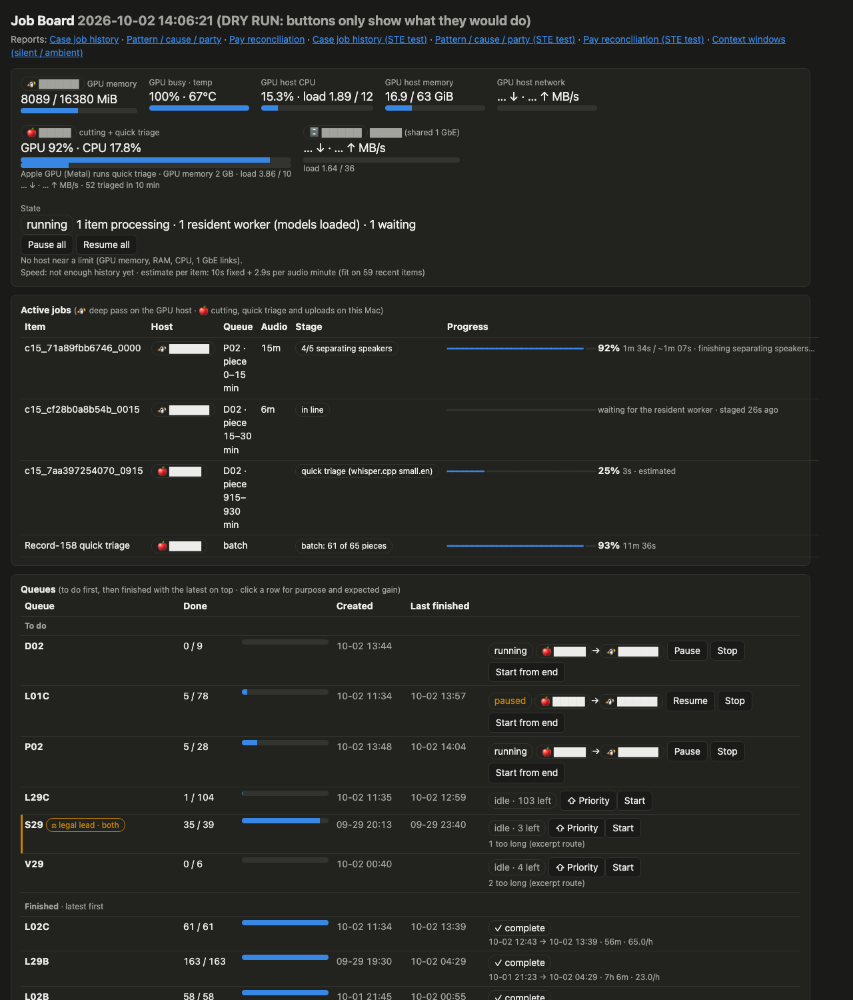

# phone-net · I.C.K.S.

**(phone + net + I.C.K.S.)** · phone+net+tics · *let your phone talk to you*

**Intake · Custody · Keywords · Synthesis**

**Live page:** https://the1truedan.github.io/phone-net-ICKS/ · v0.9.0 PAPER TRAIL edition (2026-11-05) · [PAPER TRAIL one-pager](https://the1truedan.github.io/phone-net-ICKS/paper-trail.html) · [Sessions of Therapy](https://the1truedan.github.io/phone-net-ICKS/sessions.html) · public since 2026-09-30 · MIT

A local-only toolkit for family caregivers. It turns the recordings, emails and letters on your **own** phone into an indexed, checksummed, searchable record. With that record you can ask care agencies precise questions in writing, and show how each answer was found.

It was built by one caregiver, between shifts, with AI coding assistants writing the code and every recording staying on local hardware.

> **What is in this repo:** code, config templates, pages and aggregate numbers only.
> **What never is:** recordings, transcripts, names, addresses, case details, or anyone's health information. See `docs/PRIVACY.md`.

## Latest · v0.9.0 · PAPER TRAIL edition (2026-11-05)

*Nickname: the P.A.P.E.-r trail.* The paper side arrives. **P.A.P.E.** (Paper Accessibility, Parsing & Evidence) joins the phone pulls
in [`scripts/pape/`](scripts/pape/README.md): a document feeder scanner turns notices, care plans and receipts into searchable PDFs
that screen readers can use (PDF/UA-1, checked with veraPDF), with the same custody files as a phone pull. It also audits public
websites, PDFs and links for accessibility (WCAG 2.1 AA), keeps broken links with the date they broke, and shows what changed
between two versions of an official document. All local. One-pager: [PAPER TRAIL](https://the1truedan.github.io/phone-net-ICKS/paper-trail.html).

Released at 11:23 PM, 48 minutes after v0.8.1 below.
P.A.P.E. runs from the command line, so the Mac app stays at **0.8.1** (`phone-net-ICKS_0.8.1_aarch64.dmg`, on the v0.8.1 release page).

## v0.8.1 · PLUG AND PLAY edition (2026-11-05)

Plug the phone in; the pull starts on its own. A patch on top of GREEK SQUAT:

- **Auto-pull on plug-in (desktop app):** when a phone listed in `pulls.json` is plugged in, the app runs the owner's own pull
  once per plug-in (skips if one is running or the last pull was under 30 minutes ago; `auto_pull: false` turns it off).
  Each phone card shows **Last pull** age: amber after 1 day, red after 3, "plug in to pull".
- **Pull new files from the app:** picks up from the last custody log, names the next folder, shows live progress, reads the
  phone model from the phone. The on-phone status page opens in the phone's default browser.
- **Job board, clearer:** one lane per host, pipelines with stages, a status file a job can write so its row stays honest while
  the log is quiet, "idle (no update for N min)" instead of a false "running", a 15-day archive, five looks (Default, Classic,
  High contrast, Terminal, Retro) and a Compact view.
- **Game mode (optional):** one toggle on the board pauses the GPU jobs and opens the game launcher; "done" closes it and resumes.

The Mac installer is version 0.8.1 too: `phone-net-ICKS_0.8.1_aarch64.dmg` on the [v0.8.1 release page](https://github.com/the1truedan/phone-net-ICKS/releases/tag/v0.8.1).

**The breakthrough: from "why isn't it automatic?" to auto-pull in 80 seconds.** From the session history ([AgentsView](https://github.com/kenn-io/agentsview); session IDs only, no care-record text). Central time.

- **Nov 1, 3:38 AM:** *"can i plug in the play to use the app for the recon pull?"* 20 minutes later the app had a **Pull new files** button (`3e10d32`, session `6d0b256a`). It sat on a side branch.
- **Nov 2, 11:21 AM:** first real pull from the app. Next ask: have the job board pick up every new pull by itself.
- **4:25 PM:** auto-pull on plug-in written and saved, but not built.
- **4:30:25 PM:** *"dude why the f is the mac app not auto pull on connect. was that not smoketested proper?"* The answer, 3 seconds later: no, it was never built or tested.
- **4:30:53 PM:** built in 17 seconds. **4:31:45 PM:** the phone on the cable started its pull by itself about 5 seconds after the app opened. **Call-out to working: 1 min 20 s.** The miss became a rule: a feature isn't done until it has run on a real phone.
- **4:35 PM:** the progress page opens in the phone's own browser. **7:46 PM:** game mode on the job board.
- **Nov 5, 5:37 PM:** *"redesign job board time now"*, plus *"can the blink pull stats and other background jobs better inform status and progress"* (session `88460753`). Result: host lanes, honest idle rows, a 15-day archive and five looks, released 10:35 PM (session `955c38eb`).
- **Nov 6, 12:03 AM:** the care program's own services report, read on the home computer, set side by side with what was confirmed in writing (`848e35d`).
- **Nov 7, 7:51 AM:** a paper letter arrived. Scanned at 7:51, first draft reply at 7:54: **3 minutes from scanner to draft** (P.A.P.E., session `6c4fae0f`).
- **Nov 7, morning:** one pass gathered 299 photos and videos and 120 recordings across 28 dates. A phone was cleared of 64.2 GB, and every delete was checked again first (session `6c4fae0f`).
- **Nov 7, 8:51 AM:** 94 payroll exports, pulled over two months, compared line by line. Every change made after the fact shows by date, and no entry was lost (session `6c4fae0f`).
- **Nov 7, afternoon:** a miss became a rule again. A 26-hour recording went whole to the GPU computer, the same file that had run it out of memory before. The fix: a 3-hour cap and 15-minute pieces. By evening, 186 of 189 priority recordings had speaker names (session `50346b21`).
- **Nov 7, evening:** an authorization report turned into a timeline: 9 authorization numbers, what was said vs what was authorized. A phone's own message log answered "we can't get texts" in seconds: every text had a delivery report (read-only, over the cable).
- **Nov 7, 7:28 PM:** the job board's "At a glance" view: one column per computer, one bar per job, and what is on each GPU now (`2b94252`).
- **Nov 7, 9:01 PM:** a gap found in the transcription pipeline: 1,237 recordings the GPU computer would never give its second model. The idle Mac took them that night.
- **Nov 7, night:** a 4 min 27 s timelapse of every note, visit, call and email, with cited quotes, built in one evening from local data. A new export added 272 care notes the timeline was missing (session `50346b21`).

## v0.8.0 · GREEK SQUAT edition (2026-11-02)

**When someone you love passes, their heart and mind are on their phone.** GREEK SQUAT ("it's all Greek to me"; *squat*,
the data left behind) lets a caregiver or next of kin plug that phone in, do the few steps only a person can do, and then
step away while the computer secures everything, with a status screen on the loved one's own phone. A reverse prep:
*prepare for the care when we cannot be there.*

- **One cable, Android or Apple:** texts, picture messages and attachments, calls, contacts, calendar and storage over adb; a full
  local backup for iPhone and iPad that starts by itself when the device says Trust. Local disk only.
- **Voicemail:** carrier voicemail is locked inside the voicemail app; GREEK SQUAT saves each one through the app's own Share
  button and lists who and when.
- **Status on their phone:** a full-screen progress page served through the same USB cable (counts only, no names).
- **The person / machine line:** consent steps stay with the person (Trust, Google and Facebook exports, passwords).
- **Desktop app:** the first installable build, for Mac (Apple silicon), unsigned, checksum on the release page. **Windows and Linux follow in the next few days** after testing. See below.
- **Earmarked next:** an Android app (a pocket recon kit: one phone saves another over USB-C) and an iOS app (status and capture).
- **Rest first:** after a final night of care, one nap; then 1 h 54 min from the first word to this release. [The one-pager](https://the1truedan.github.io/phone-net-ICKS/greek-squat.html).
- For the executor or next of kin, with the device passcode. Archive **before** reporting the death to Google, Yahoo or Facebook.

### v0.7.9 · Spit Take edition (2026-10-30)

**A DNA file read after 9 years on the shelf.** A raw genotype file from a 2017 research study had only ever been glanced at
(45 pasted markers). In one evening, on the home computers, the new DNA module read all of it and gave the family private,
large-type pages. No DNA left the house: only gene names and marker IDs went to public databases.

- **Scope:** 563,289 markers (100% called), 731 Y and 310 mitochondrial markers.
- **Tools:** yhaplo (23andMe, `pip install` from GitHub) for the father's line, haplogrep3 (release tarball, Java 17) for the mother's line, numpy / pandas / matplotlib for checks and charts.
- **Known-variant check:** public ClinVar lists matched locally with a strict rule (same rsID and the changed letter). A loose first pass gave a false alarm; the strict rule removed it.
- **Ancestry:** 1000 Genomes frequencies (26 populations), scored locally. The slow part is the network, not the computer.
- **Paper trail:** three genealogy programs exported and cross-checked; one birth certificate settled the disagreements.
- How to run it: [`docs/DNA_MODULE.md`](docs/DNA_MODULE.md). Details: [CHANGELOG](CHANGELOG.md).

### v0.7.8 · na^3 boo x2 edition (2026-10-27)

**Hard week, calm letters.** In a week of round-the-clock care, the toolkit checked a late agency reply against the written list
of meeting promises (1 of 10 items arrived) and turned the gaps into numbered questions with one answer date.

- **Cite rule:** a model's red flag counts only when it cites a numbered record line. A script removes uncited claims.
- **One address, three microphones:** an email address spelled aloud at a meeting was found on 1 of 3 recordings.
- **Portal that cannot forward:** export the sent text, then paste it into a plain email that uses initials only.
- **Old budget sheet vs new:** compared on the home computer only. Exact hours stay in the private record.
- **Hospice care at home since Oct 14, 2026.** At the Oct 21 meeting the team said 10.5 h a day and listed 10 items to send. By Oct 27, 1 had arrived and 0 of the hours were in writing. **Update Oct 28:** both offices confirmed in writing 10.5 h a day for Oct 21 to 31, and the corrected 6.5 h from Sep 1. **Update Nov 3–4:** the agency's own services report (Nov 3) authorizes **5.2 h a day from Sep 1** (6.5 confirmed in writing) and **9.0 h a day from Oct 21** (10.5 confirmed): **81.25 hours fewer** than confirmed in writing. The records request came back as **one 145-page scan with no text layer**, then was marked closed. On Nov 4 the grievance was closed on administrative grounds with the open items unanswered; the family asked in writing to keep it open. [Live stats](https://the1truedan.github.io/phone-net-ICKS/#totals).
- **53 old files into custody** with SHA-256, originals not moved. Details: [CHANGELOG](CHANGELOG.md).

### v0.7.7 · Disclosure Edition (2026-10-19)

**Real life, in the open.** This week the family used the toolkit to ask a care agency, its payroll company and an
independent advocate for one meeting, with full disclosure both ways. Every letter came from the indexed record. Every quote was
checked against its source before it went out.

- **20 faxes delivered** since Sep 1. 3 more failed at the receiving machine, and an email copy went instead.
- **41 letters and email drafts** checked before sending since Oct 14 (facts, dates, tone, legal wording), with 23 saved revisions.
- **1 all-caps subject line** changed to "Please reply by…". Calm and exact is stronger.
- Source: the [By the numbers](https://the1truedan.github.io/phone-net-ICKS/#totals) chart on the live page (counts only).

**No PHI. No PII.** These numbers tell the story with counts alone. That is possible because the record is **disaggregated**: each
recording, note and letter is its own checksummed item, and its date, source and hash are kept apart from its content. The content
stays on local hardware. Only the counts travel. *More on the method soon.*

## Desktop app (from v0.8.0): install

Download the file for your computer from the [Releases](https://github.com/the1truedan/phone-net-ICKS/releases) page.

**The installers are not signed.** Code signing costs money every year, and this app is free and open source. Your computer
will warn you the first time. That is expected. To check that your download is the real one, compare it with `SHA256SUMS.txt`
on the release page (`shasum -a 256 <file>` on Mac and Linux, `certutil -hashfile <file> SHA256` on Windows).

| Computer | File | First time you open it |
| --- | --- | --- |
| **Mac** (Apple silicon: M1 or newer) | `phone-net-ICKS_0.8.1_aarch64.dmg` | Drag the app to Applications and open it. macOS says it cannot check it. Click **Done**, then open **System Settings → Privacy & Security**, scroll down and click **Open Anyway**, and enter your password. Once is enough. |
| **Windows** 10 or 11 *(in the next few days)* | `.msi` or `.exe` | Windows SmartScreen says it protected your PC. Click **More info**, then **Run anyway**. |
| **Linux** (64-bit Intel/AMD) *(in the next few days)* | `.deb` or `.AppImage` | `.deb`: `sudo apt install ./phone-net-ICKS_0.8.1_amd64.deb`. `.AppImage`: `chmod +x` the file, then run it. No warning. |

Older Macs (Intel) are not supported yet. On macOS 14 and earlier you can also Control-click the app and choose **Open**.

## Job board (v0.5.0, updated v0.6.0)
A local page (127.0.0.1 only) to watch and steer the GPU transcription queues: GPU host CPU/memory/GPU and temperature,
items on the GPU with uv-style progress bars (real stage + time left), Start now / Start from end for any queue, Pause/Stop per runner, done/total per queue, recently finished items, pause/resume/start/stop, automatic
cleanup of abandoned staging copies, highlighted queues (e.g. ⚖ legal lead), and formatted local reports.
Since v0.5.6: **Active jobs** for both computers (GPU deep pass and the Mac's cutting, quick triage and uploads, each with a host badge and progress bar),
CPU / GPU / network per host with a plain-language **saturation** line, and to-do queues listed above finished ones (latest finish on top).
Since v0.5.8: **Coverage** watches the checksum list that every phone pull writes and checks each recording, by hash, against the
catalog, the results and the queues. One button queues what nothing covers; one adds new files to the catalog.
Since v0.6.0: an **out-of-date light** on every report page and in the report list (green / yellow / red / grey) from the
newest phone, task, calendar, email or camera data each report depends on (`freshness_sources`, per-report `sources`,
`freshness_red_h`); hours and minutes everywhere; live reload of queue and batch lists; a panel for what is using the Mac GPU.
Camera-clip work runs as short urgency queues (expiring first, then daytime, then deep early-morning scrolls) and each to-do
line is stamped pulled / not in the app list / past the scroll limit / queued after every run.

Standard library only. See `stack/jobboard/README.md`, `stack/requirements/jobboard.txt` and the public-safe example
`docs/examples/case-job-history.example.html`.

## Tools added in v0.6.0

- `scripts/lbf_extract.py`: reads an LG Bridge `.lbf` full-phone backup without the vendor app. Skips the small scrambled index,
  streams the ZIP entries with their original paths and dates, writes a SHA-256 manifest of every entry and extracts databases
  and recordings. Read-only on the backup; hash the original and the copy first.

## What it does

| Stage | What happens |
|---|---|
| **Intake** | USB-C pull from the phone (`adb`), diff against earlier backups by name and size, then verify size and SHA-256 |
| **Custody** | Checksums on every copy and output. True recording dates are recovered from audio metadata when file dates are only copy dates |
| **Keywords** | Level the audio, transcribe it (WhisperX), label speakers (pyannote plus your own voiceprints), run a keyword sweep, then meaning search |
| **Synthesis** | Local summaries, a dated index, packets tiered by audience (family, care team, advocate, counsel), and a methods note |

## By the numbers (2026-10-12)

2,436 phone-pull recordings checked by hash (2,430 covered) · ~760 hours transcribed on local hardware · 4,715 speaker-separated outputs (incl. 1,089 fifteen-minute chunks) · 296 named-caller voicemails QC'd with speaker-name confidence · 325 home-camera clips pulled and timestamp-checked · 568 ledger days · one 16 GB GPU. Full table: `docs/STATS.md`.

## Pages

| Page | What it shows |
|---|---|
| [`index.html`](https://the1truedan.github.io/phone-net-ICKS/) | Summary, breakthroughs timeline, totals and methods |
| [`analytics.html`](https://the1truedan.github.io/phone-net-ICKS/analytics.html) | Daily strips: care notes, emergencies, AI sessions, commits, hours vs the paid cap |
| [`workflow.html`](https://the1truedan.github.io/phone-net-ICKS/workflow.html) | From the phone to the local "black box", with every tool linked |

## Files

| Path | Purpose |
|---|---|
| `docs/PIPELINE.md` | Stages and lessons |
| `docs/MODELS_AND_APPROVALS.md` | Free tools, models, and the Hugging Face gated approvals |
| `docs/BUILD.md`, `stack/` | Docker compose and per-part requirements |
| `docs/STATS.md` | Aggregate numbers (no PII) |
| `docs/PRIVACY.md` | What never goes in this repo |
| `docs/EARMARK_*.md` | Next modules: `cut.glass` (a consent-based, read-only audit of a caregiver app), the real hours-gap chart, and two computers working at once plus a fast first hash (`EARMARK_DUAL_HOST_FAST_HASH.md`) |
| `config/icks.example.yaml` | Paths template. The real `icks.yaml` is git-ignored |
| Session history | Breakthrough citations are checked against a local [AgentsView](https://github.com/kenn-io/agentsview) index |
| `CHANGELOG.md` | What changed in each version, including the breakthroughs |

Working scripts are ported into `scripts/` only after sanitization.

## Self-directed services: official sources

The page explains the roles (the member, the managed care organization, the fiscal employer agent, the county, the caregiver) without naming any organization. Sources:
[Medicaid.gov: Self-Directed Services](https://www.medicaid.gov/medicaid/long-term-services-supports/self-directed-services) ·
[WI DHS SDS FAQ, P-00088N](https://www.dhs.wisconsin.gov/publications/p0/p00088n.pdf) ·
[WI DHS SDS in Family Care, P-00593](https://www.dhs.wisconsin.gov/publications/p0/p00593.pdf) ·
[WI DHS IRIS](https://www.dhs.wisconsin.gov/iris/index.htm) ·
[WI DHS member rights and appeals](https://www.dhs.wisconsin.gov/familycare/fullpartner.htm)

## The larger µlab (M.A.N.A.G.E.R. LLC)

phone-net · I.C.K.S. is one door in a larger µlab. The sibling public repos:

| Repo | Page | What it is |
|---|---|---|
| [ai-gateway](https://github.com/the1truedan/ai-gateway) | [page](https://the1truedan.github.io/ai-gateway/) | Home LLM gateway: routes models across machines. The local gateway these pages refer to |
| [mok-tua](https://github.com/the1truedan/mok-tua) | [page](https://the1truedan.github.io/mok-tua/) | Script → storyboard stills → optional video, on your own GPU |
| [fast-models](https://github.com/the1truedan/fast-models) | [page](https://the1truedan.github.io/fast-models/) | Two spare NVMe drives turned into one fast, deduped model pool |
| [grok-tua-tok-tua](https://github.com/the1truedan/grok-tua-tok-tua) | [page](https://the1truedan.github.io/grok-tua-tok-tua/) | Coding CLIs next to a live health and spend pane |
| [johnny-appleseed-chipper](https://github.com/the1truedan/johnny-appleseed-chipper) | [page](https://the1truedan.github.io/johnny-appleseed-chipper/) | Artifact manifests (C.H.I.P.P.E.R.S.) and custody receipts (C.H.A.I.N.S.) |
| [aida-complex-doc-lab](https://github.com/the1truedan/aida-complex-doc-lab) | [page](https://the1truedan.github.io/aida-complex-doc-lab/) | A.I.D.A. complex-document accessibility harness |
| [ada-doc-check](https://github.com/the1truedan/ada-doc-check) | – | Prepare-only ADA/WCAG-style document triage |
| [cmip-terpene-db](https://github.com/the1truedan/cmip-terpene-db) | [page](https://the1truedan.github.io/cmip-terpene-db/) | Schema ideas for cannabis and hemp chemistry |
| [all-in-one-home-food-bank-tank-rank](https://github.com/the1truedan/all-in-one-home-food-bank-tank-rank) | – | Local-first home food bank |
| [shreddit](https://github.com/the1truedan/shreddit) | [Greasy Fork](https://greasyfork.org/en/scripts/589405-shreddit) | Userscript: modern Reddit as a wide, fast reading view |

## License

[MIT](LICENSE)

---

  
  
  
  

**© 2026 M.A.N.A.G.E.R. LLC** — *prepare for the care when we cannot be there*
