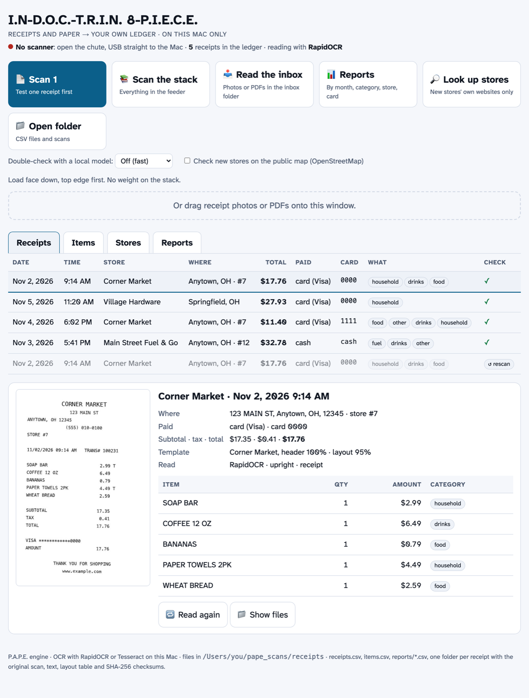
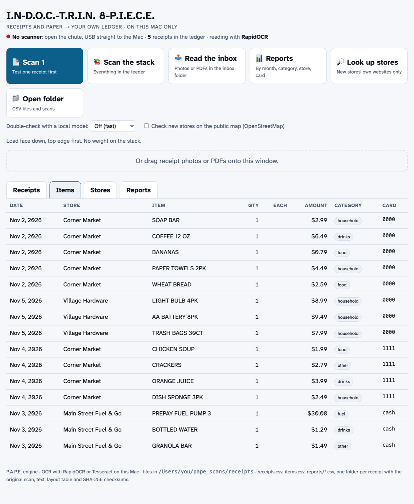
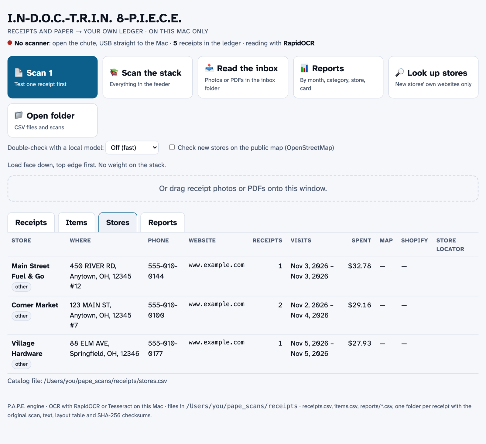
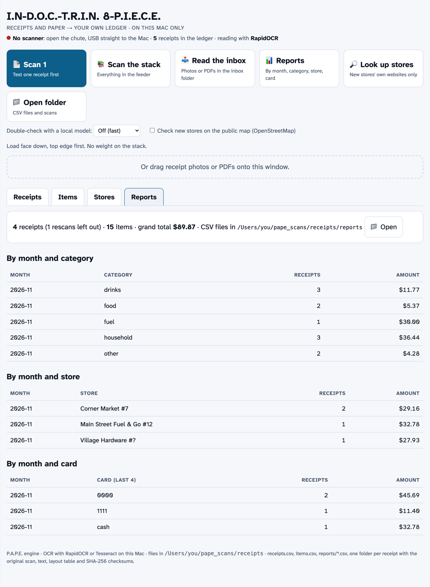

# I.N-D.O.C.-T.R.I.N. 8-P.I.E.C.E. (alpha)

**Receipts and paper → your own ledger, on your own Mac.** A small Mac app over the P.A.P.E. receipt engine
(`scripts/pape/pape_receipt.py`). Scan a stack of paper receipts (or drop photos and PDFs on the window) and get
spreadsheets of dates, times, stores, totals, items, categories and how each one was paid. Nothing is uploaded.

> **Alpha.** It works on the owner's own receipts and on the made-up receipts in the screenshots. Expect rough
> edges (listed below). Unsigned: the first time, right-click the app and choose **Open**.



## What it does

- **Scan 1** (test one receipt first), **Scan the stack** (everything in the feeder), **Read the inbox**
  (photos or PDFs in `~/pape_scans/receipts/inbox`), or drag files onto the window.
- Reads each receipt: store, address, store number, date, time, items with quantity and price, subtotal, tax,
  total, card (last 4 digits only) or cash.
- **Learns each store's layout** from its header and keeps a template, so later receipts from the same store read
  better and misread store names get corrected.
- **Catches rescans:** the same receipt scanned twice is kept once (the clearer scan); the other copy is marked
  *rescan* and left out of totals.
- **Fixes small misreads** against what that store has sold before (the original reading is kept).
- **Sorts purchases into categories** (food, drinks, household, fuel, care & medical, …). Add your own words in
  `~/pape_scans/receipts/categories.json`.
- **Reports** by month, category, store and card, as CSV files.
- Optional: double-check each receipt with a local model (Ollama), check new stores on OpenStreetMap, and look up
  a store's own website. All off by default.

| Items | Stores | Reports |
|---|---|---|
|  |  |  |

## Where the files go

`~/pape_scans/receipts/`: `receipts.csv`, `items.csv`, `stores.csv`, `reports/*.csv`, and one folder per receipt
with the original scan, the text, the layout table and SHA-256 checksums.

Your own store list stays private in `~/pape_scans/receipts/local_rules.json` (see
`scripts/pape/local_rules.example.json`). The app ships with **no** store names; it learns stores from your receipts.

## Needs

- macOS on Apple silicon.
- Best reading: the P.A.P.E. tools (`scripts/pape/pape_install_tools.sh`: RapidOCR + OpenCV). Without them it falls
  back to Tesseract (`brew install tesseract`), which reads thermal receipts much worse.
- Scanning: `brew install sane-backends`. Load receipts **face down, top edge first**, no weight on the stack.

## Rough edges (alpha)

- Unsigned app: right-click → Open the first time.
- Tested with one sheet-fed scanner model only (a Fujitsu ScanSnap S1500 over SANE).
- Tuned on a small number of store layouts; a new store's first receipt may need a look (it gets flagged).
- Stores learned from receipts start in the category **other** until you add them to `local_rules.json`.
- Faded or crumpled thermal paper reads poorly. Flatten under a book; never iron thermal paper.
- The screenshots use made-up stores, addresses and card numbers.

## Build

```sh
cd indoc/src-tauri && cargo tauri build --bundles app
```

The engine is built into the app and written to `~/pape_scans/receipts/.engine/` on start.
